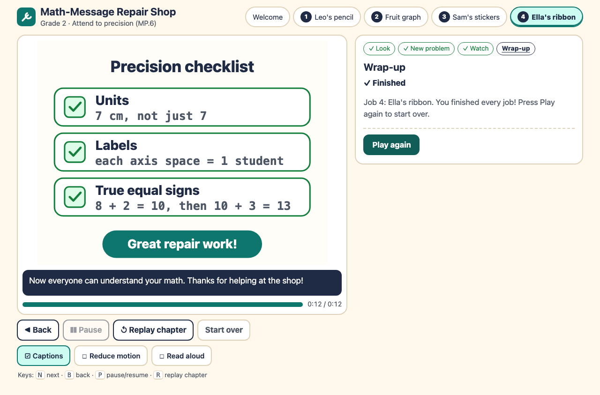
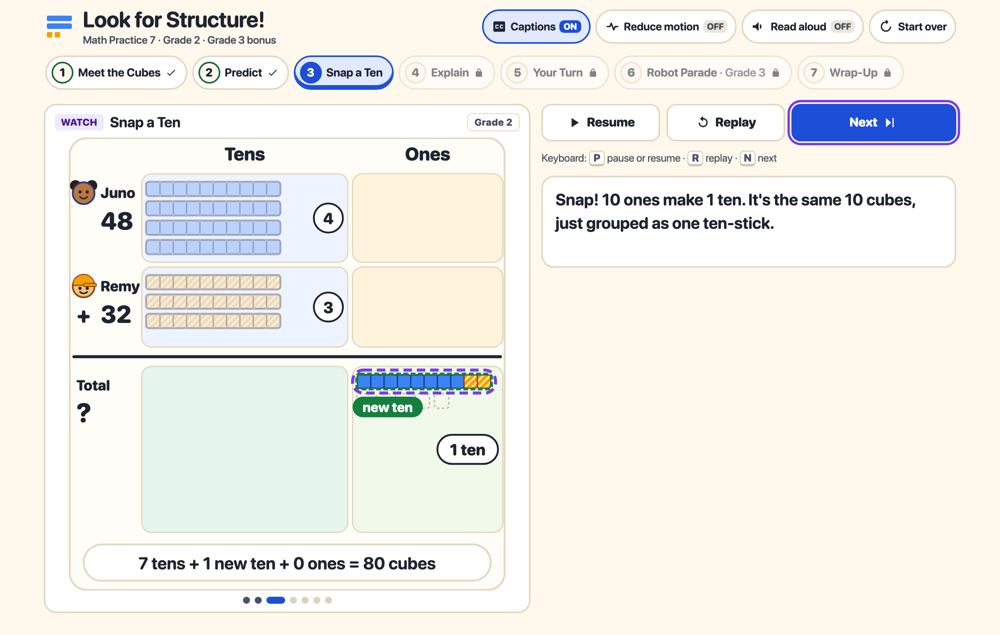
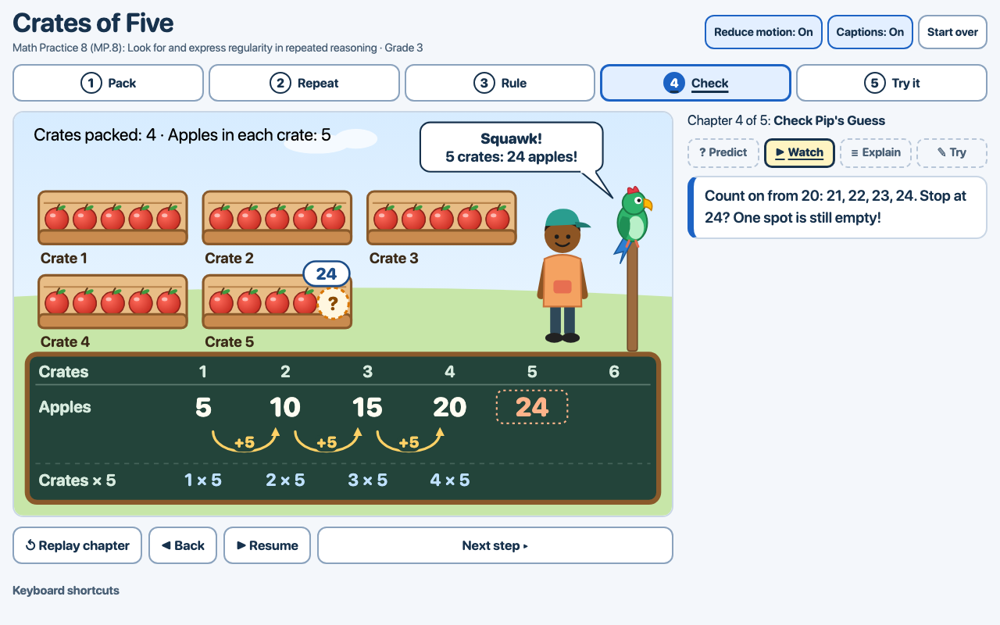

# Elementary Math Practice Animations

Three interactive math animations for Grades 1–3 (ages 6–9). Each one teaches a Common Core Standard for Mathematical Practice through a short original story. They are built with Next.js, React, TypeScript, and inline SVG. None of them needs a backend, API key, paid service, or external asset.

Each project stands on its own, with its own dependencies, tests, screenshots, and verification report.

| Project | Practice | Grade | Story | Tests |
| --- | --- | --- | --- | --- |
| [P113 · Attend to precision](P113-attend-to-precision) | MP.6 | 2 | **Math-Message Repair Shop:** fix a length with no unit, a mislabeled graph axis, and the false chain `8 + 2 = 10 + 3 = 13` | 80 unit · 45 e2e |
| [P114 · Look for and make use of structure](P114-make-use-of-structure) | MP.7 | 2 (+ Grade 3 bonus) | **Snap-Cube Robots:** `48 + 32`, where 8 ones + 2 ones make a new ten, so the total is 80; bonus: a 3-by-4 array grouped by rows and then by columns | 131 unit · 38 e2e |
| [P115 · Look for and express regularity in repeated reasoning](P115-repeated-reasoning) | MP.8 | 3 | **Crates of Five:** equal groups of 5 give 5, 10, 15, 20; learners connect this to crates × 5 and check a parrot's wrong guess of 24 | 57 unit · 39 e2e |

Every lesson follows a **predict → animate → explain → try** sequence and has these features:

- Start, pause/resume, replay, and learner-controlled next steps.
- Questions wait for the learner and give specific corrective feedback, followed by one new transfer question.
- Keyboard and touch support, captions, cues that don't rely on color alone, and a reduced-motion mode.
- Answers stay hidden before submission, including from accessible text.
- One deterministic math model drives every quantity, coordinate, label, and answer check.

## Screenshots

| P113 | P114 | P115 |
| --- | --- | --- |
|  |  |  |

## Run a project

These commands need Node.js 20.9 or newer (tested on Node 22.12.0). Each project uses its own port: 3113, 3114, or 3115.

```bash
cd P113-attend-to-precision   # or P114-make-use-of-structure, P115-repeated-reasoning
npm install
npm run dev                   # http://localhost:3113 (3114 / 3115)
```

Tests:

```bash
npm test                          # unit tests (Vitest): math model, lesson script, state machine
npx playwright install chromium   # once, for end-to-end tests
npm run test:e2e                  # Playwright: controls, keyboard/touch, feedback, reduced motion, rapid input, answer leaks
```

Each project folder has a `README.md` with setup details and a `VERIFICATION.md` with the math and visual verification report. That report separates tests that were actually run from code review only.
